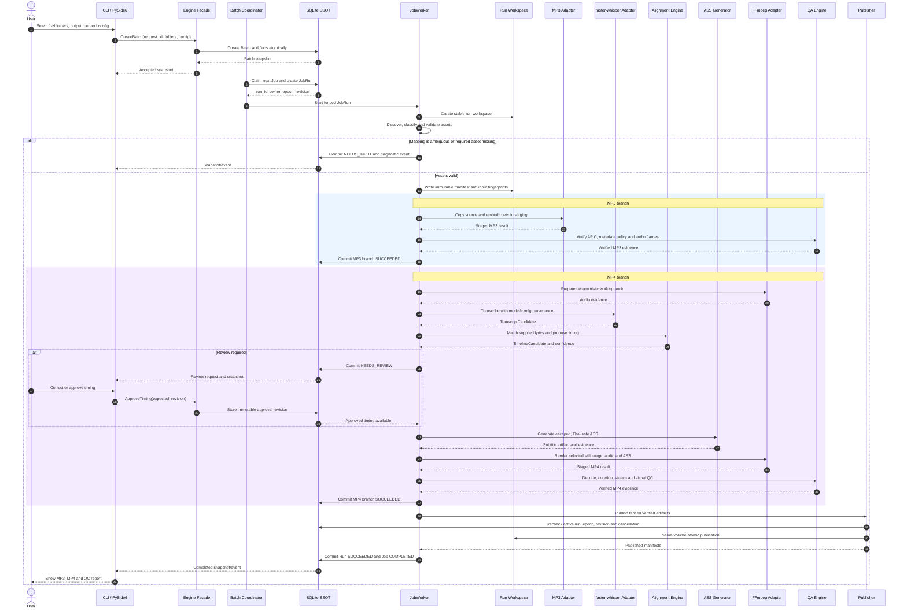
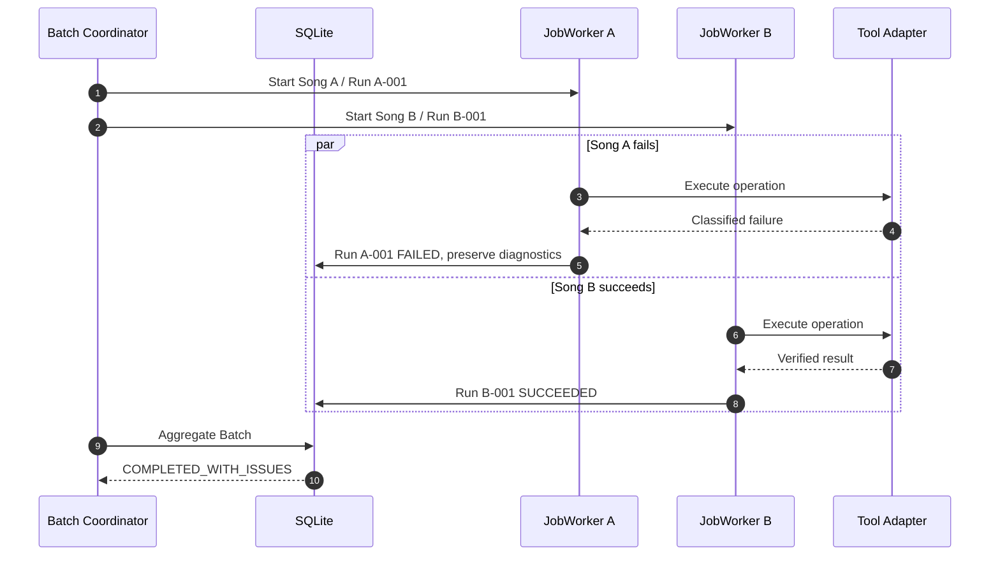
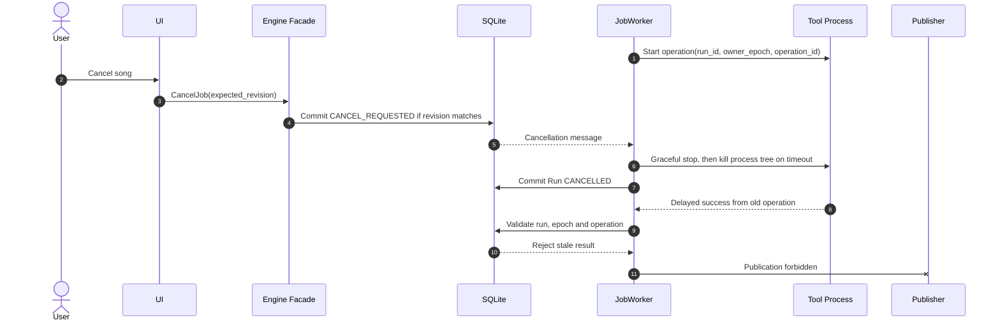

# End-to-end execution sequences

Status: approved architecture contract. These sequences implement ADR-0003 and are acceptance-test sources.

## Participants and ownership

- UI/CLI sends commands and reads snapshots/events; it never calls media tools or SQLite directly.
- Engine Facade validates commands and optimistic revisions.
- Batch Coordinator admits jobs under configured worker/resource limits.
- One JobWorker owns one active JobRun and serializes its state changes.
- Tool adapters return typed results and never mutate operational state.
- SQLite is operational truth; the Job workspace contains manifest, staging, evidence and diagnostic logs.
- Publisher accepts only artifacts from the active fenced run after QC.

## Happy path: one song end to end



## Failure isolation across songs



## Whole-run retry

```mermaid
sequenceDiagram
    autonumber
    actor User
    participant UI
    participant E as Engine Facade
    participant DB as SQLite
    participant B as Batch Coordinator
    participant J as New JobWorker
    participant W as Workspace

    User->>UI: Retry failed song
    UI->>E: RetryJob(job_id, expected_revision)
    E->>DB: Verify no active run and prior run is terminal
    DB-->>E: Run A-001 FAILED
    E->>DB: Create Run A-002 with new owner epoch and snapshots
    E->>W: Create new RUN-A-002 workspace
    E-->>B: Queue Run A-002
    B->>J: Start Run A-002
    J->>J: Restart from intake; do not reuse prior staging
```

## Cancellation and stale-result rejection



## Restart after application crash

On startup, the coordinator marks an interrupted non-terminal run as `INTERRUPTED`; it does not infer success from staging files and does not resume midway. Diagnostics and staged files are retained or quarantined according to retention policy. The operator or configured policy creates a new run from intake. Verified artifacts are never deleted implicitly.

## Required sequence tests

- Happy path with supplied approved timing.
- `NEEDS_INPUT` asset mapping and `NEEDS_REVIEW` timing approval.
- MP3 success plus MP4 failure yields `PARTIAL_SUCCESS`.
- One song fails while sibling jobs continue.
- Retry creates new IDs, workspace and fingerprints.
- Cancel competes with tool completion; only one valid revision wins.
- Delayed old-run result cannot mutate state or publish.
- Crash/restart never reports staging as published success.
